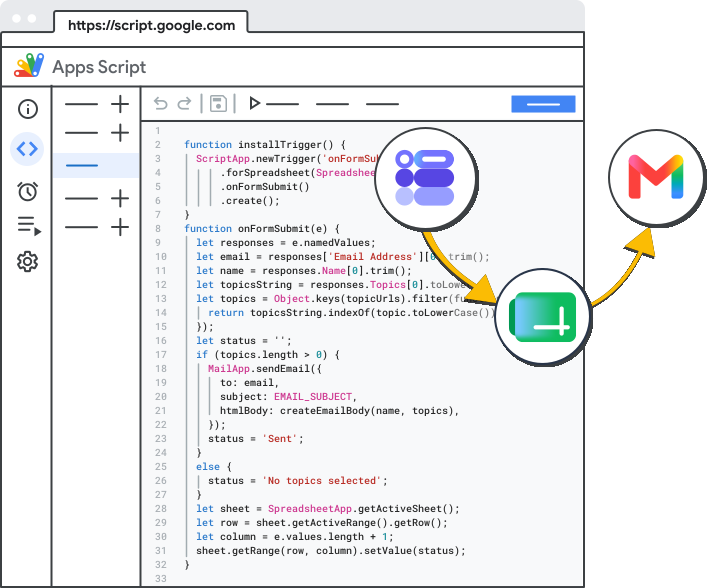

# Google App Scripts Examples

The following are examples of how to use [Google App Scripts](https://developers.google.com/apps-script):

- [Hello World](./hello_world/helloWorld.gs) example.

- [Inserting Date](./insert_date/insertDate.gs) example from the [Google Apps Script for Beginners: Start Automating Google Sheets](https://www.youtube.com/watch?v=8UmdqwY9AdA) video.

## License

This project is licensed under the [MIT License](./LICENSE).
